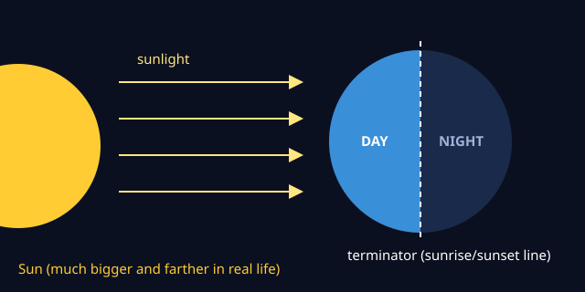

# What causes day and night?

> **How to use this lesson.** Every big idea has an interactive picture. Drag the sliders, press Play, and try the "Try this" questions before you read on. On a phone, use the **Open full screen** link under each picture.

## Warm-up

This is the pilot, so it runs before Lessons 1.1 and 1.2. The warm-up uses what you already know and the Universe Sandbox orientation (Unit 0).

1. In Universe Sandbox, how do you pause the simulation, and how do you make time run faster?
2. On which side of the sky does the Sun come up in the morning?
3. Roughly how long is one day, in hours?

*(Answers: 1. from the Unit 0 orientation; 2. over the eastern horizon (the exact spot shifts north and south with the seasons); 3. about 24 hours.)*

## Hook

> "When it's night here, where does the Sun go?"

## Words you'll need

These words come up in this lesson. Play with the globe below until each one makes sense.

- **Axis:** an imaginary straight line through the middle of Earth, from top to bottom. Earth turns around it, like a wheel turns around its axle.
- **North Pole** and **South Pole:** the two places where the axis comes out of Earth's surface.
- **Equator:** an imaginary line around the middle of Earth, exactly halfway between the North and South Poles. It is the longest circle you can draw around Earth from east to west.
- **Latitude:** how far north or south of the equator a place is, measured in degrees (°). The equator is 0°, the North Pole is 90° north. Manor, Texas is about 30° north.
- **Horizon:** the line where the ground (or sea) seems to meet the sky.
- **Orbit:** the path one object takes around another. Earth's orbit around the Sun takes one year.

<iframe src="interactive/earth-parts.html" title="Interactive globe: Earth's axis, poles, equator, and how fast the ground moves" width="100%" height="880" loading="lazy" style="border:0;border-radius:8px"></iframe>

[Open full screen: Earth's axis, poles and equator](interactive/earth-parts.html)

**Try this:** Press *Equator*, then *North Pole*. Which one rides around a bigger circle in one spin? (OpenStax 4.1)

## Core idea

### 1. The Sun lights one half of Earth at a time

Earth is a ball, and the Sun shines on it from one side. The half of Earth that faces the Sun has **day**: sunlight reaches the ground there. The half that faces away has **night**: it is in Earth's own shadow. The line that divides the lit half from the dark half is called the **terminator**. In this simple model, anyone standing on the terminator is seeing a sunrise or a sunset. (Real sunrise and sunset are a little blurrier, because Earth's air bends and scatters sunlight; see "Go deeper.") (OpenStax 4.1)

The Sun never "goes" anywhere at night. It is still shining. It is just shining on the other side of Earth, where people are having their daytime.

### 2. Earth spins, and carries us through the light and the dark

Earth turns around its axis. This turning is called **rotation**. Earth rotates about once every 24 hours. As it turns, it carries you from the dark half into the lit half (sunrise), across the lit half (midday), into the dark half again (sunset), and through the night until you come back around. (OpenStax 2.1, 4.1)

A **solar day** is the time from one local noon to the next, about 24 hours. (**Local noon** is the moment the Sun is highest in your sky.) That is actually a little more than one full turn, for a reason explained in "Go deeper." (OpenStax 4.3)

<iframe src="interactive/day-night.html" title="Interactive: spin the Earth and watch day and night from space and from a backyard in Manor" width="100%" height="1010" loading="lazy" style="border:0;border-radius:8px"></iframe>

[Open full screen: Spin the Earth](interactive/day-night.html)

**Try this:**
- Find the moment Manor crosses the terminator into the light. What does the backyard view show at that moment?
- Change how long Earth takes to spin once to 48 hours and press Play. How long does daytime last now?

The ground under you is moving fast. At the equator it travels about 1,670 km per hour (about 1,040 miles per hour). In Manor, which is farther from the equator, it is about 1,450 km per hour (about 900 miles per hour). The globe in "Words you'll need" works this out for any place. We don't feel it because the turning is very smooth and steady, and the air, the house, and everything around us move along with us. *(Worked from Earth's equator, about 40,075 km around, turning once in about 23.9 hours.)*

### 3. Why the Sun seems to move across the sky

Earth spins from **west to east**. Seen from above the North Pole, that is counterclockwise. Because we are carried eastward, the Sun appears to move the opposite way: it seems to rise over the eastern horizon, cross the sky, and set over the western horizon. (The exact spot where it rises shifts north and south through the year; that is part of the seasons, in Unit 3.) The Moon and the stars seem to move the same way, for the same reason. This is called **apparent motion**: it is how things look from a spinning Earth, not how they actually move. (OpenStax 2.1, 4.1)

It is like riding a merry-go-round: the playground seems to slide past you the other way, even though it is you who is moving.

**Try this:** In the Spin the Earth interactive above, tick *What if Earth spun the other way?* Predict first: where would the Sun come up?

**A common mix-up:** Day and night are *not* caused by Earth moving around the Sun. That trip, its orbit, takes a whole year. Day and night come from the spin.

## How do we know?

For most of history, "the Sun goes around Earth" and "Earth spins" looked exactly the same from the ground. Two pieces of evidence settle it. For each one, see how it was done, then check it yourself.

### Evidence 1: Foucault's pendulum (1851)

A **pendulum** is a weight hanging on a string or wire that can swing freely. Once it is swinging, a pendulum keeps swinging in the same direction unless something pushes it sideways.

**How it was done.** In 1851 Léon Foucault hung a 28 kg (62 lb) ball on a wire 67 m (220 ft) long from the dome of the Panthéon in Paris. A pointer under the ball traced its path in a thin layer of sand on the floor. Hour by hour, the line of the swing slowly turned, about 11° every hour. Nothing was pushing it. The swing was keeping its direction while the floor, and all of Paris, turned underneath it. (OpenStax 4.1; [APS News: February 3, 1851: Léon Foucault Demonstrates That Earth Rotates](https://www.aps.org/apsnews/2007/02/foucault-earth-rotates); [Britannica: Foucault pendulum](https://www.britannica.com/science/Foucault-pendulum))

**Why it counts as evidence.** The amount it turns depends on where on Earth the pendulum is. It turns a full circle in a day at the poles, about 32 hours in Paris, and not at all at the equator. That is exactly what a spinning Earth predicts, and it is what pendulums all over the world measure.

<iframe src="interactive/foucault.html" title="Interactive: how Foucault's pendulum experiment was set up, what it shows from above, and how to check it at home" width="100%" height="1130" loading="lazy" style="border:0;border-radius:8px"></iframe>

[Open full screen: Foucault's pendulum](interactive/foucault.html)

**Check it yourself:**
- At home: build the lazy-Susan pendulum in tab 3 of the interactive.
- In person: many science museums and universities run a Foucault pendulum, often with pegs that it knocks down through the day. Search for "Foucault pendulum" plus your city to find one.

### Evidence 2: Photos of the whole Earth from space

**How it is done.** NASA's EPIC camera rides on the DSCOVR **spacecraft** (a machine that travels in space), which sits between Earth and the Sun, about 1.6 million km (1 million miles) from Earth. From there it always sees Earth's sunlit side, and it takes a set of photos every day. Lined up in order, the photos show the continents rolling into view on one side and out of view on the other, while the sunlit side keeps facing the Sun. ([NASA: Daily Views of Earth Available on New NASA Website](https://www.nasa.gov/news-release/daily-views-of-earth-available-on-new-nasa-website); [NASA Science: As the World Turns](https://science.nasa.gov/resource/as-the-world-turns/))

<iframe src="interactive/space-camera.html" title="Interactive: where NASA's EPIC camera is and what it sees as Earth turns, with a photo strip" width="100%" height="1110" loading="lazy" style="border:0;border-radius:8px"></iframe>

[Open full screen: Photos of Earth from a million miles away](interactive/space-camera.html)

**Check it yourself:** Open NASA's EPIC website at [epic.gsfc.nasa.gov](https://epic.gsfc.nasa.gov/) and step through one day's real photos from first to last. Or watch NASA's one-day animation, [As the World Turns](https://science.nasa.gov/resource/as-the-world-turns/).

**Illustration or evidence?** The interactives in this lesson, the Universe Sandbox exercise, and the flashlight demo only *illustrate* the idea: they show what a spinning Earth would look like, because they were built to spin. The evidence is the measurements: Foucault's pendulum and the real photos from space.

## Predict, then check

**Predict:** It is noon on a sunny day in Manor, Texas. Is it day or night in Tokyo, Japan, on the other side of the world? Commit to an answer before you check.

Check

Night. Tokyo is roughly on the opposite side of Earth from Texas. When Manor faces the Sun, Tokyo faces away from it. Noon in Manor is about 3 a.m. the next morning in Tokyo in winter, and about 2 a.m. in summer. Every place on Earth takes its turn in the light.

**See it:** In the Spin the Earth interactive, tick *Show Tokyo, Japan* and set the time in Manor to 12:00 p.m.

**Predict, part 2:** If Earth suddenly spun twice as fast, how long would a day (one sunrise to the next) be?

Check

About 12 hours: about 6 hours of daylight and 6 of darkness, on average. Day length depends on how fast Earth spins. (Earth won't do this. It is a "what if" question.)

**See it:** In the Spin the Earth interactive, change how long Earth takes to spin once to 12 hours, press Play, and read the daytime length.

## Lab

- **Sky Lab:** *Manor Sunrise* (being built; see `specs/`). Turn the Earth in the space view and watch the Sun rise over the backyard horizon at the moment Manor crosses the terminator.
- **Universe Sandbox:** [Universe Sandbox walkthrough for this lesson](https://github.com/beloo2010/learn-astro/blob/main/sandbox/u01-l03.md) (in the course's GitHub repository). Watch Earth turn from space, keep the lit half facing the Sun, then slow the spin and see the day get longer. *(Draft. Steps are unverified until we run it together.)*

## Teach-back

Explain this in 2–3 sentences, as if to your 9-year-old. Then Claude asks the kind of follow-up questions a child would ask. If your answers hold up, we move on. If one wobbles, we re-explain it briefly and add it to the revisit list.

Questions Claude may ask (don't read these first):

Child-style follow-ups

- "If Earth is spinning so fast, why don't we fly off or get dizzy?"
- "Where does the Sun go at night?"
- "Is it night everywhere at the same time?"
- "Does the Sun move at all?"
- "Why does the Sun always come up on the east side?"
- "How do you *know* Earth is spinning, if you can't feel it?"
- "Why are some days longer than others?" *(Good answer: that's the seasons, which is Unit 3. For now, the spin explains day and night; the tilt explains why their lengths change.)*
- "Does the Moon have day and night too?"

**What a solid teach-back includes:** the Sun lights one half of Earth; Earth spins about once a day; the spin carries us into and out of the light. A bonus point for saying how we know (the pendulum or the photos from space).

## Family kit

- **Trivia:** the family quiz on the course site, filtered to lesson `u01-l03` (stored in `trivia/u01-earth.json`).
- **Show me (flashlight and ball):** In a dark room, put a lamp or flashlight on a table as the Sun. Put a small sticker on an orange or ball for your home, and turn the ball slowly from west to east (counterclockwise when you look down at the top). Ask: "When is it sunrise for the sticker? Noon? Sunset? Midnight?" Then hold the ball still and walk the flashlight around it, and ask: "Which way matches the evidence?" (Both look the same from the sticker, which is why the pendulum and the space photos matter.)
- **Show me (lazy-Susan pendulum):** Tab 3 of the Foucault interactive. The children turn the table and watch the swing keep pointing at the door.
- **Show them on screen:** The Spin the Earth interactive with the twilight and Tokyo options turned on makes a good 5-minute family demo.

## Go deeper (optional)

### Why noon-to-noon is a little longer than one spin

Measured against the distant stars, Earth turns once in about 23 hours 56 minutes, which is called a **sidereal day** ("star day"). A solar day is about 4 minutes longer, because Earth also moves along its orbit during the day, so it has to turn a little more to face the Sun again. (OpenStax 4.3)

<iframe src="interactive/star-day.html" title="Interactive: why a solar day is longer than one spin against the stars" width="100%" height="960" loading="lazy" style="border:0;border-radius:8px"></iframe>

[Open full screen: Star day and Sun day](interactive/star-day.html)

### Not exactly half and half

Earth's air bends sunlight a little over the horizon, and **twilight** (the glow in the sky before sunrise and after sunset) lights the sky even when the Sun is just below the horizon. So the change from day to night is gradual, not a sharp line. Tick *Show twilight* in the Spin the Earth interactive to see the band.

## Printable diagrams

For printing, or if the interactives don't load:

Sunlight lights one half of Earth

Earth from above the North Pole

## Sources

- OpenStax *Astronomy 2e*, section 2.1, The Sky Above: <https://openstax.org/books/astronomy-2e/pages/2-1-the-sky-above>
- OpenStax *Astronomy 2e*, section 4.1, Earth and Sky (axis, poles and equator; Foucault's pendulum): <https://openstax.org/books/astronomy-2e/pages/4-1-earth-and-sky>
- OpenStax *Astronomy 2e*, section 4.3, Keeping Time (solar and sidereal days): <https://openstax.org/books/astronomy-2e/pages/4-3-keeping-time>
- APS News, "February 3, 1851: Léon Foucault Demonstrates That Earth Rotates": <https://www.aps.org/apsnews/2007/02/foucault-earth-rotates>
- Encyclopaedia Britannica, "Foucault pendulum": <https://www.britannica.com/science/Foucault-pendulum>
- NASA, "Daily Views of Earth Available on New NASA Website" (DSCOVR/EPIC, 2015): <https://www.nasa.gov/news-release/daily-views-of-earth-available-on-new-nasa-website>
- NASA EPIC image archive: <https://epic.gsfc.nasa.gov/>
- NASA Science, "As the World Turns" (one day of EPIC images): <https://science.nasa.gov/resource/as-the-world-turns/>

*All links checked on 2026-11-22.*
