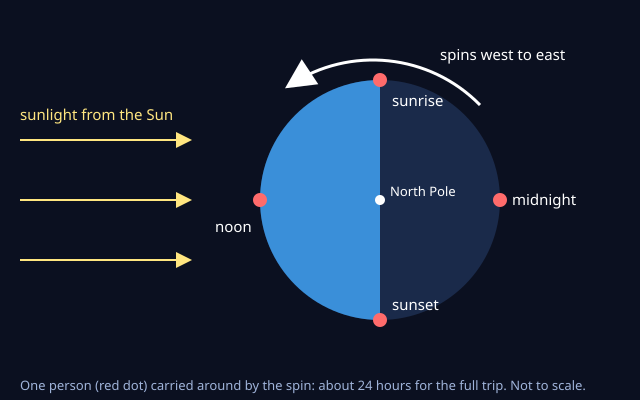

# What causes day and night?

## Warm-up

This is the pilot, so it runs before Lessons 1.1 and 1.2. The warm-up uses what you already know and the Universe Sandbox orientation (Unit 0).

1. In Universe Sandbox, how do you pause the simulation, and how do you make time run faster?
2. Which comes up in the morning on the east side of the sky: the Sun, or the Moon, or can it be either?
3. Roughly how long is one day, in hours?

*(Answers: 1. from the Unit 0 orientation; 2. the Sun always rises in the east, and the Moon also rises in the east, at different times on different days; 3. about 24 hours.)*

## Hook

> "When it's night here, where does the Sun go?"

## Core idea

### 1. The Sun lights one half of Earth at a time

Earth is a ball, and the Sun shines on it from one side. The half of Earth that faces the Sun has **day**: sunlight reaches the ground there. The half that faces away has **night**: it is in Earth's own shadow. The line that divides the lit half from the dark half is called the **terminator**. Anyone standing on the terminator is seeing a sunrise or a sunset. (OpenStax 4.1)

The Sun never "goes" anywhere at night. It is still shining. It is just shining on the other side of Earth, where people are having their daytime.

### 2. Earth spins, and carries us through the light and the dark

Earth turns around an imaginary line through the North and South Poles. That line is its **axis**, and the turning is called **rotation**. Earth rotates once about every 24 hours. As it turns, it carries you from the dark half into the lit half (sunrise), across the lit half (midday), into the dark half again (sunset), and through the night until you come back around. (OpenStax 4.1)

One full turn, measured from one noon to the next, is a **solar day**: about 24 hours. (OpenStax 4.3)

The ground under you is moving fast. At the equator it travels about 1,670 km per hour (about 1,040 miles per hour). Here in Manor, Texas, which is farther from the equator, it is about 1,450 km per hour (about 900 miles per hour). We don't feel it because the turning is very smooth and steady, and the air, the house, and everything around us move along with us. *(Worked from Earth's equator, about 40,075 km around, turning once in about 23.9 hours; Manor is at about 30° north.)*

### 3. Why the Sun seems to move across the sky

Earth spins from **west to east**. Seen from above the North Pole, that is counterclockwise. Because we are carried eastward, the Sun appears to move the opposite way: it seems to rise in the east, cross the sky, and set in the west. The Moon and the stars seem to move the same way, for the same reason. This is called **apparent motion**: it is how things look from a spinning Earth, not how they actually move. (OpenStax 2.1, 4.1)

It is like riding a merry-go-round: the playground seems to slide past you the other way, even though it is you who is moving.

**A common mix-up:** Day and night are *not* caused by Earth moving around the Sun. That trip, called an **orbit**, takes a whole year. Day and night come from the spin.

## How do we know?

For most of history, "the Sun goes around Earth" and "Earth spins" looked exactly the same from the ground. Two pieces of evidence settle it.

1. **Foucault's pendulum (1851).** Léon Foucault hung a heavy ball on a very long wire in Paris and set it swinging. A pendulum keeps swinging in the same direction unless something pushes it sideways. Over the hours, the floor slowly turned underneath the swing, so the line of the swing seemed to rotate. That only happens if the ground itself is turning. Museums around the world still run Foucault pendulums. (OpenStax 4.1; [Foucault pendulum, Wikipedia overview with references](https://en.wikipedia.org/wiki/Foucault_pendulum))
2. **Pictures of the whole Earth from space.** NASA's EPIC camera, on the DSCOVR spacecraft about 1.5 million km (about 1 million miles) away, photographs the sunlit side of Earth many times a day. Lined up in order, the photos show continents rolling into view from one side and out the other, while the sunlit side keeps facing the Sun. ([NASA: Daily views of Earth available on new NASA website](https://www.nasa.gov/news-release/daily-views-of-earth-available-on-new-nasa-website); [NASA EPIC image archive](https://epic.gsfc.nasa.gov/))

Note: the Universe Sandbox exercise below and the household demonstration only *illustrate* the idea. They show what a spinning Earth would look like. The evidence that it really happens is the pendulum and the photos above.

## Predict, then check

**Predict:** It is noon on a sunny day in Manor, Texas. Is it day or night in Tokyo, Japan, on the other side of the world? Commit to an answer before you open the check.

Check

Night. Tokyo is roughly on the opposite side of Earth from Texas. When Manor faces the Sun, Tokyo faces away from it. Noon in Manor is about 3 a.m. the next morning in Tokyo in winter, and about 2 a.m. in summer. Every place on Earth takes its turn in the light.

**Predict, part 2:** If Earth suddenly spun twice as fast, how long would a day (one sunrise to the next) be?

Check

About 12 hours: about 6 hours of daylight and 6 of darkness, on average. Day length depends on how fast Earth spins. (Earth won't do this. It is a "what if" question.)

## Lab

- **Sky Lab:** *Manor Sunrise* (being built; see `specs/`). Turn the Earth in the space view and watch the Sun rise over the backyard horizon at the moment Manor crosses the terminator.
- **Universe Sandbox:** [`sandbox/u01-l03.md`](../../sandbox/u01-l03.md). Watch Earth turn from space, keep the lit half facing the Sun, then slow the spin and see the day get longer. *(Draft. Steps are unverified until we run it together.)*

## Teach-back

Explain this in 2–3 sentences, as if to your 9-year-old. Then Claude asks the kind of follow-up questions a child would ask. If your answers hold up, we move on. If one wobbles, we re-explain it briefly and add it to the revisit list.

Questions Claude may ask (don't read these first):

Child-style follow-ups

- "If Earth is spinning so fast, why don't we fly off or get dizzy?"
- "Where does the Sun go at night?"
- "Is it night everywhere at the same time?"
- "Does the Sun move at all?"
- "Why does the Sun come up on the same side every morning?"
- "Why are some days longer than others?" *(Good answer: that's the seasons, which is Unit 3. For now, the spin explains day and night; the tilt explains why their lengths change.)*
- "Does the Moon have day and night too?"

**What a solid teach-back includes:** the Sun lights one half of Earth; Earth spins once a day; the spin carries us into and out of the light. A bonus point for saying how we know (the pendulum or the photos from space).

## Family kit

- **Trivia:** `trivia/u01-earth.json`, items tagged `u01-l03`.
- **Show me (flashlight and ball):** In a dark room, put a lamp or flashlight on a table as the Sun. Put a small sticker on an orange or ball for your home, and turn the ball slowly from west to east (counterclockwise when you look down at the top). Ask: "When is it sunrise for the sticker? Noon? Sunset? Midnight?" Then hold the ball still and walk the flashlight around it, and ask: "Which way matches the evidence?" (Both look the same from the sticker, which is why the pendulum and the space photos matter.)

## Go deeper (optional)

- **The day is not exactly 24 hours of spin.** Measured against the distant stars, Earth turns once in about 23 hours 56 minutes, which is called a **sidereal day**. The extra 4 minutes or so in a solar day happen because Earth moves along its orbit during the day, so it has to turn a little more to face the Sun again. (OpenStax 4.3)
- **Not exactly half and half.** Earth's air bends sunlight a little over the horizon, and twilight lights the sky before sunrise and after sunset. So the change from day to night is gradual, not a sharp line.

## Sources

- OpenStax *Astronomy 2e*, section 2.1, The Sky Above: [openstax.org/books/astronomy-2e/pages/2-1-the-sky-above](https://openstax.org/books/astronomy-2e/pages/2-1-the-sky-above)
- OpenStax *Astronomy 2e*, section 4.1, Earth and Sky: [openstax.org/books/astronomy-2e/pages/4-1-earth-and-sky](https://openstax.org/books/astronomy-2e/pages/4-1-earth-and-sky)
- OpenStax *Astronomy 2e*, section 4.3, Keeping Time: [openstax.org/books/astronomy-2e/pages/4-3-keeping-time](https://openstax.org/books/astronomy-2e/pages/4-3-keeping-time)
- NASA, Daily views of Earth available on new NASA website (DSCOVR/EPIC): <https://www.nasa.gov/news-release/daily-views-of-earth-available-on-new-nasa-website>
- NASA EPIC image archive: <https://epic.gsfc.nasa.gov/>
- Foucault pendulum overview: <https://en.wikipedia.org/wiki/Foucault_pendulum>
